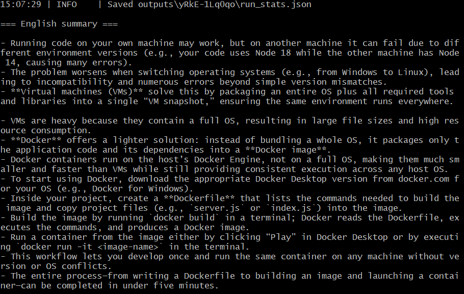
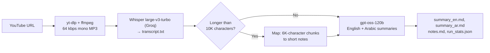

# Whisper YouTube Summarizer

**Paste a YouTube link, get a transcript plus an English and an Arabic summary — one command, free APIs.**


[Sample run](#sample-run) · [How it works](#how-it-works) · [Results](#results-real-runs) · [Example outputs](examples/) · [Evaluation notes](docs/evaluation.md)

---

## The problem

Long videos — lectures, tutorials, talks — take as long to watch as they run. Often you only
need the key points, or you need them in another language: an Arabic summary of an English
tutorial, or an English summary of an Arabic talk.

This tool downloads the audio, transcribes it with **Whisper**, and asks an **LLM** for two
summaries: English bullet points and an Arabic summary with a title and a conclusion.
In a real run, a 32-minute English tutorial was processed in **under 4 minutes**.

## Sample run



*End of a real run: the English summary of a 3-minute Arabic video. Arabic text is best read in
the saved `summary_ar.md`, because most terminals do not display right-to-left text correctly.*

## How it works



1. **Download** — `yt-dlp` fetches the best audio track; `ffmpeg` re-encodes it to 64 kbps mono
   16 kHz MP3. Speech does not need music quality, and small files upload faster
   (measured: 14.88 MB for 32.5 minutes, so the 25 MB API limit allows about 50 minutes).
2. **Transcribe** — the MP3 is sent to Whisper (`whisper-large-v3-turbo`) through Groq's
   OpenAI-compatible API. The language is auto-detected, or set with `--language`.
3. **Summarize** — `openai/gpt-oss-120b` writes both summaries from the transcript.
   Long transcripts use **map-reduce**: split into chunks, turn each chunk into notes (map),
   then summarize the notes (reduce). This keeps every request under the free tier's
   tokens-per-minute limit.
4. **Save** — everything goes to `outputs/<video_id>/`, including `run_stats.json` with
   timings and token counts.

## Features

- **One command** from URL to transcript + two summaries
- **Arabic and English** speech, with language auto-detection
- **Long videos** handled with map-reduce summarization
- **Free to run** on Groq's free tier; switch to any OpenAI-compatible API by editing `.env`
- **Automatic retries** when the API rate limit is hit (HTTP 429)
- **Everything saved**: transcript, summaries, intermediate notes, and run stats
- **Clear errors** for a missing API key, missing ffmpeg, bad URLs and rate limits

## Results (real runs)

Two public YouTube videos, one run each, on a Windows PC with a consumer internet connection,
Groq free tier. Source: [`examples/*/run_stats.json`](examples/).

| | [Docker in 5 mins](https://www.youtube.com/watch?v=yRkE-1Lq0qo) | [GitHub Actions Tutorial](https://www.youtube.com/watch?v=R8_veQiYBjI) |
|---|---:|---:|
| Spoken language | Arabic (Egyptian dialect) | English |
| Video length | 3 min 15 s | 32 min 30 s |
| Audio uploaded | 1.49 MB | 14.88 MB |
| Transcript | 533 words | 5,019 words |
| Download + convert | 7.9 s | 37.5 s |
| Transcription | 15.9 s (**12.3×** real time) | 150.1 s (**13.0×** real time) |
| Summarization | 2.4 s (2 requests) | 36.4 s (7 requests: 5 map + 2 final) |
| **Total** | **26.2 s** | **224.0 s** |

*Real-time factor = video length ÷ transcription time (includes uploading the audio).*

### What evaluation changed

Checking the first long-video summaries against the transcript revealed four problems — for
example, a section labelled *"German/Chinese notes"* in the summary of an all-English video.
After fixing them, on the same video and the same transcript:

| | Before | After |
|---|---:|---:|
| Chat API requests | 9 | 7 |
| Prompt + completion tokens | 18,298 | 12,821 |
| Summarization time | 76.1 s | 36.4 s |
| English summary length | ~110 lines | 12 bullets |

Details, causes, fixes and an error analysis (speech-recognition vs LLM mistakes) are in
[docs/evaluation.md](docs/evaluation.md).

## Example inputs and outputs

This project does not train a model, so there is no training dataset. The test inputs are two
public YouTube videos (linked above); each folder in [`examples/`](examples/) contains:

| File | Content |
|---|---|
| `transcript_excerpt.txt` | First lines of the Whisper transcript, unedited |
| `summary_en.md` | English bullet-point summary |
| `summary_ar.md` | Arabic summary with title and conclusion |
| `notes.md` | Map-step notes (long video only) |
| `run_stats.json` | Timings, sizes, token counts, models used |

Full transcripts are not committed because they are the creators' content — run the tool to
regenerate them.

**Sample — Arabic video → both summaries**

Transcript (Whisper, unedited):

> عندما تجي تكتب كود وتشغله عندك على المشين هتلاقيه شغال تمام معاك بس تجي تروح تشغله على جهاز حد تاني احتمال ليه ما يشتغلش …

English summary (first bullet):

> - Running code on your own machine may work, but on another machine it can fail due to different environment versions (e.g., your code uses Node 18 while the other machine has Node 14, causing many errors).

Arabic summary (title and first bullet):

> **ملخص الفيديو: لماذا نحتاج Docker وكيفية استخدامه**
>
> - تشغيل الكود على جهازك قد يعمل بدون مشاكل، لكن عند نقله إلى جهاز آخر قد يواجه أخطاء بسبب اختلاف إصدارات الأدوات (مثال: Node 18 على جهازك vs Node 14 على الجهاز الآخر).

## Tech stack

| Part | Tool |
|---|---|
| Language | Python 3.10+ |
| Audio download | yt-dlp (+ yt-dlp-ejs and Deno for YouTube's JavaScript challenges) |
| Audio conversion | ffmpeg |
| Speech-to-text | Whisper `whisper-large-v3-turbo` via Groq |
| Summaries | `openai/gpt-oss-120b` via Groq |
| API client | OpenAI Python SDK (OpenAI-compatible API) |
| Config | python-dotenv (`.env`) |

## Project structure

```
whisper-youtube-summarizer/
├── yt_summarizer/
│   ├── __main__.py      # CLI: python -m yt_summarizer "<URL>"
│   ├── config.py        # reads settings from .env
│   ├── downloader.py    # yt-dlp + ffmpeg -> small MP3
│   ├── transcriber.py   # Whisper speech-to-text
│   ├── summarizer.py    # English + Arabic summaries, map-reduce for long texts
│   ├── pipeline.py      # runs the steps, saves outputs and run_stats.json
│   └── errors.py        # user-facing error type
├── examples/            # real outputs from two test videos
├── docs/evaluation.md   # how the outputs were checked and improved
├── assets/              # README images
├── .env.example         # copy to .env and add your API key
├── requirements.txt     # pinned Python dependencies
└── LICENSE
```

## Getting started

**Requirements:** Python 3.10+, ffmpeg, and a free Groq API key from
[console.groq.com/keys](https://console.groq.com/keys).

**1. Install ffmpeg** (once):

| OS | Command |
|---|---|
| Windows | `winget install --id=Gyan.FFmpeg -e` (then reopen the terminal) |
| macOS | `brew install ffmpeg` |
| Ubuntu / Debian | `sudo apt install ffmpeg` |

**2. Clone and install:**

```bash
git clone https://github.com/anaskasasbeh/whisper-youtube-summarizer.git
cd whisper-youtube-summarizer
python -m venv venv
source venv/Scripts/activate      # Windows (Git Bash)
# venv\Scripts\activate           # Windows (cmd)
# source venv/bin/activate        # macOS / Linux
pip install -r requirements.txt
```

**3. Add your API key:**

```bash
cp .env.example .env              # Windows cmd: copy .env.example .env
```

Open `.env` and paste your key after `API_KEY=`. The `.env` file is git-ignored.

## Usage

```bash
python -m yt_summarizer "https://youtu.be/VIDEO_ID"
python -m yt_summarizer "https://youtu.be/VIDEO_ID" --language ar
```

| Option | Description |
|---|---|
| `-l`, `--language` | Spoken language as an ISO-639-1 code (`ar`, `en`, …). Default: auto-detect |
| `-o`, `--out` | Output folder. Default: `outputs` |
| `--keep-audio` | Keep the downloaded MP3 |
| `-v`, `--verbose` | Show debug logs |

Results are saved in `outputs/<video_id>/`:
`transcript.txt`, `summary_en.md`, `summary_ar.md`, `notes.md` (long videos only) and
`run_stats.json`.

### Configuration (`.env`)

| Variable | Default | Purpose |
|---|---|---|
| `API_KEY` | — | Your API key (required) |
| `API_BASE_URL` | `https://api.groq.com/openai/v1` | Any OpenAI-compatible endpoint |
| `TRANSCRIBE_MODEL` | `whisper-large-v3-turbo` | Speech-to-text model |
| `SUMMARY_MODEL` | `openai/gpt-oss-120b` | Chat model for the summaries |
| `REASONING_EFFORT` | `low` | For reasoning models; leave empty for others |

## Limitations

- **Video length:** about 50 minutes at most, because speech-to-text APIs accept files up to
  25 MB. Longer audio is not split yet.
- **Rate limits:** on the free tier, long videos pause and retry automatically when the
  tokens-per-minute limit is reached, which adds waiting time.
- **YouTube changes:** downloads depend on yt-dlp keeping up with YouTube, and YouTube often
  blocks requests from cloud servers ("Sign in to confirm you're not a bot"). The tool is meant
  to run on your own machine.
- **Recognition errors:** Whisper makes more mistakes on English technical terms spoken inside
  Arabic (e.g. "errors" was transcribed as "ايروز"), and those mistakes reach the summaries.
- **LLM additions:** the summarizer sometimes adds details from general knowledge — both
  summaries of the English example include a version tag (`@v2`) that was never said. Check names, numbers and versions
  against `transcript.txt`.
- **Arabic output:** occasional spelling mistakes were seen in Arabic summaries during testing.
- **No automated tests yet.**

## Future work

- Split audio longer than 25 MB into parts so any video length works
- Unit tests for text splitting and map-reduce, run on every push with GitHub Actions
- A small evaluation set to compare models and prompts with the same metrics
- Optional local Whisper (e.g. faster-whisper) to transcribe without an API
- Timestamps for each summary bullet, using Whisper's segment times

## Credits and license

- Example videos belong to their creators and are linked above; only short transcript
  excerpts are included in this repository.
- Code released under the [MIT License](LICENSE).
- Version 2 (October 2026) rewrote the original 2025 Colab script into a CLI package and moved
  from the OpenAI API to Groq's free tier.

Built by **Anas Kasasbeh** · [GitHub](https://github.com/anaskasasbeh) ·
[LinkedIn](https://www.linkedin.com/in/anaskasasbeh) ·
[Portfolio](https://anaskasasbeh.vercel.app)
